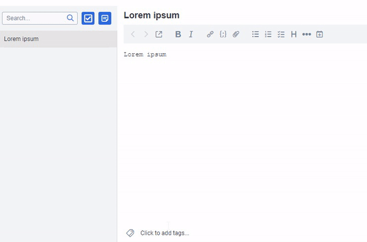

# Joplin Inline Tags Plugin

Joel's fork of [roman-r-m/joplin-inline-tags-plugin](https://github.com/roman-r-m/joplin-inline-tags-plugin)
(v1.3.0, MIT). What's different:

- Autocomplete matches anywhere in a tag's name, not only at the start (`#oo` finds `foo`).
- Matching ignores case (`#FOO` finds `foo`).
- Best matches come first: names starting with what you typed, then names where it starts a
  later word (`work/foo`), then the rest. Each group is alphabetical.
- "Create new tag" is no longer offered when the tag already exists.
- Tags already on the note are listed too, so you can type the same tag again elsewhere in it.

It has its own plugin id (`com.joelberger.inline-tags`), so uninstall the original before
installing this one or both will show a completion list.

A plugin for [Joplin](https://joplinapp.org/) that helps to quickly add/create tags while editing a note.

**Requires Joplin 1.7+ and only works in markdown editor**

## Demo

## Usage

Type `#` and select an existing tag to add it to the current note. Keep typing to narrow down the list or to create a new tag and add it to the note immediately.